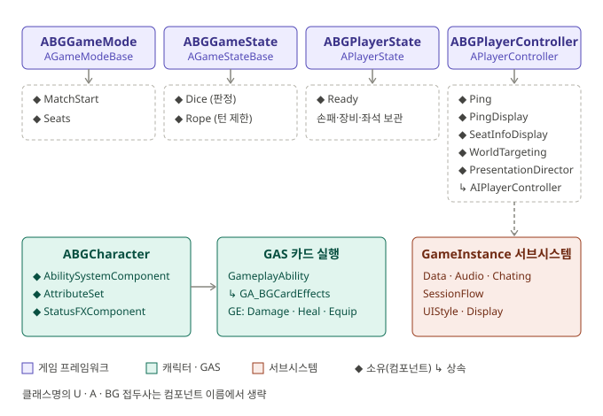
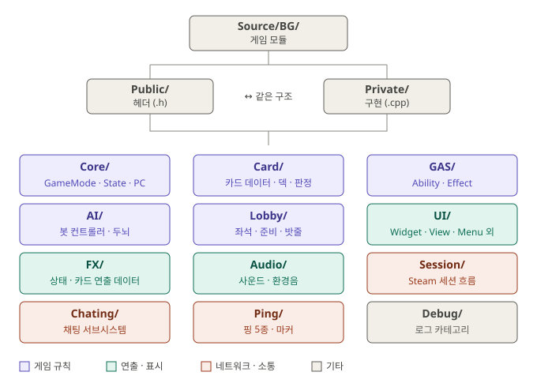

  

# [8기 3조] EmberRoad

> **모닥불 곁의 일행 중 배신자를 찾아라 — TRPG 마피아 게임**

`턴제 카드` `마피아 TRPG` `4단계 랜덤 판정` `Steam 멀티플레이`

[🎬 트레일러](https://youtu.be/AZl9mIZEfoo) · [🎮 플레이 영상](https://youtu.be/m3RMAiYG680?si=Em66f6wFhzDC9KGR) · [📦 게임 패키지](https://drive.google.com/file/d/13Yvr0Lz278qhcLHiWIUEhpS6YyyhK7Dg/view)

---

## 게임 소개

정체를 숨긴 일행이 모닥불을 둘러싸고 카드로 서로를 겨누는 턴제 카드 게임입니다. 누가 적인지 모르는 채로 카드를 내며 정체를 추리합니다. 카드를 내는 순간 판정이 따라붙어, 같은 카드도 판마다 결과가 다릅니다.

| 항목 | 내용 |
|---|---|
| 장르 | 마피아류 턴제 카드 대전 (TRPG 스타일 마피아) |
| 플랫폼 | PC |
| 인원 | PvP 4~7인 / PvE 1인 |
| 역할 | 용사(보안관) · 부관 · 마왕군(무법자) · 배신자 |

> 왕의 명령으로 마왕을 토벌하러 가던 용사 일행 속에 마왕군이 숨어 있습니다. 용사는 마왕군과 정보를 팔아넘긴 배신자를 직접 찾아내야 합니다.

### 핵심 재미

* 🎲 **4단계 확률 판정** — 대실패 · 실패 · 성공 · 대성공. 카드를 내기 전에 확률을 확인하고 위험을 감수할지 고릅니다.
* ⚔️ **장비와 직업 빌드** — 직업 12종과 장비가 성공률 · 대성공률 · 방어 확률을 바꿉니다.
* 🎭 **정체 공개와 엔딩** — 쓰러진 캐릭터의 정체가 드러나고, 승리 진영에 따라 엔딩이 갈립니다.

### 게임 모드

| PvP (4~7인) | PvE (1인) |
|---|---|
| 정체를 숨기고 겨루는 기본 모드. 역할 추리 · 공유 덱 정보전 · 확률 도박 | 용사가 되어 AI 마왕군과 5번의 조우를 돌파 |

## 기획 의도

* **단순한 선택:** 거리 계산과 복잡한 특수 규칙을 걷어내고 "누구에게 어떤 카드를 쓸 것인가"에 집중시켰습니다.
* **랜덤 확률의 재미:** 결과가 정해진 카드는 판이 반복되면 뻔해집니다. 4단계 판정으로 위험을 감수할지 매 턴 고민하게 했습니다.
* **보드게임에 연출을 얹다:** 공격·피격 확대 연출, 정체 공개, 진영별 엔딩으로 턴제가 정적이라는 인상을 바꾸고 싶었습니다.

## 기술 스택

| 항목 | 내용 |
|---|---|
| 엔진 | Unreal Engine 5.8 (C++ + Blueprint) |
| 플러그인 | GameplayAbilities (GAS), CommonUI, OnlineSubsystem · Steam · SteamSockets |
| 에셋 | [CR] [LQ] Weapon 001 Ravi [PACK], POLYGON Fantasy Kingdom |
| 협업 | Git / GitHub |

## 아키텍처

### 클래스 다이어그램

### 폴더 구조

## 팀

| 이름 | 역할 | 담당 |
|---|---|---|
| 김지원 | 팀장 | UI/UX |
| 고예현 | 프로그래머 | AI, 시스템, 전투 |
| 장진희 | 프로그래머 | UI/UX, 전투, 최적화 |
| 김재성 | 프로그래머 | FX, UI/UX |
| 신장식 | 프로그래머 | QA, 네트워크 |
| 나지호 | TA | 기획, 시스템, 애니메이션, 연출 |
| 김희재 | 레벨 디자이너 | 레벨 디자인 |
| 김훈철 | 애니메이터 | 애니메이션 |
| 양준우 | 모델링 | 모델링, 채팅 |
